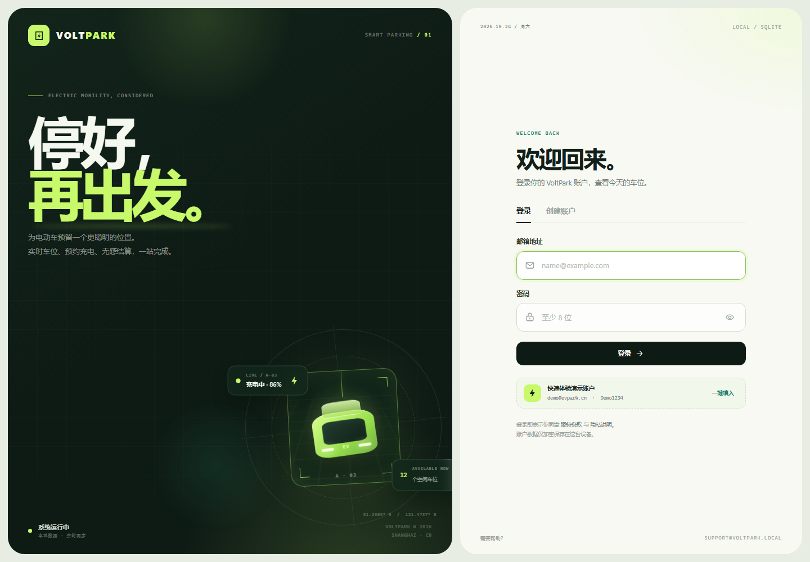
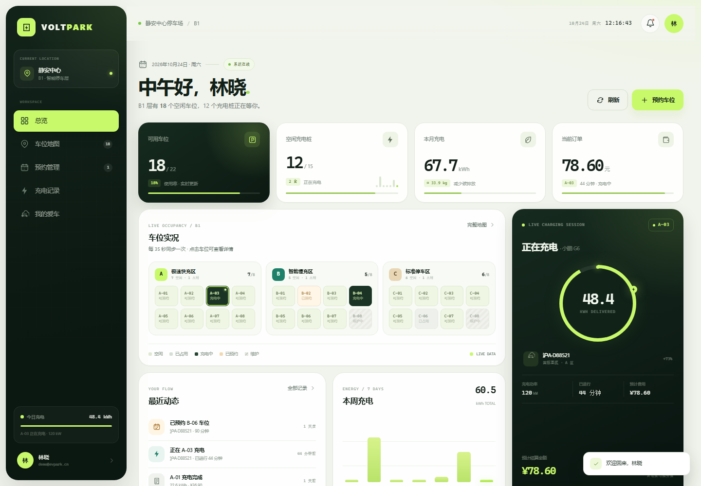
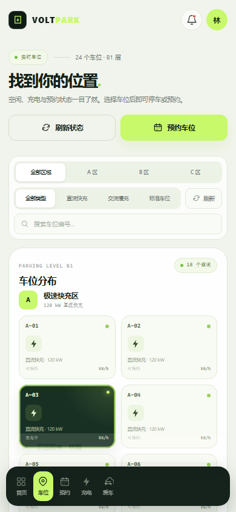

# VoltPark · 电动车智能停放系统

VoltPark 是一个可以完全在本地运行的电动车智能停车 Web 应用。它使用 **Python 标准库 + SQLite**，不依赖 Flask、Node 服务或任何外部 CDN，断网也能正常使用。

界面包含电动车充电场景的实时车位地图、预约、停车计时、充电结算、车辆管理，以及运营管理员后台。账户密码使用 PBKDF2-SHA256 加盐哈希保存，登录状态保存在 HttpOnly Cookie 中。所有业务数据（账户、车辆、车位、预约、订单、账单）都持久化在本地 SQLite 数据库中，完整表结构与查询示例见 [数据库设计](docs/数据库设计.md)。

## 界面预览

| 登录 | 工作台 |
| --- | --- |
|  |  |

移动端车位地图：



## 快速开始

当前演示服务已运行在：**http://127.0.0.1:8777**

> 页面依赖本机的后台服务。如果浏览器提示「无法访问此页面」，通常只是服务进程已停止，数据库和账户数据不会丢失。双击 `启动VoltPark.bat` 即可自动检测并重新启动，然后打开浏览器。电脑重启后也需要重新启动一次。

以后启动可以双击：

```text
启动VoltPark.bat
```

或在终端执行：

```powershell
cd ev-parking
& "$env:USERPROFILE\.dsh\dsh-runtimes\dsh-primary-runtime\dependencies\python\python.exe" server.py
```

如果系统里已有 Python 3.10+，也可以直接：

```powershell
python server.py
```

启动后在浏览器打开 `http://127.0.0.1:8777`。按 `Ctrl+C` 停止服务。

### 演示账户

| 角色 | 邮箱 | 密码 | 可体验 |
| --- | --- | --- | --- |
| 车主 | `demo@evpark.cn` | `Demo1234` | 进行中的充电订单、车位、预约、账单、车辆管理 |
| 运营管理员 | `admin@evpark.cn` | `Admin1234` | 运营看板、在场车辆、车位维护管理 |

登录页点击「一键填入」可直接使用车主演示账户。也可以在「创建账户」中注册全新账号，注册后从绑定爱车开始体验完整流程。

## 功能

### 账户与登录

- 邮箱注册、登录、退出。
- 密码至少 8 位，必须包含字母和数字。
- PBKDF2-SHA256（260,000 次迭代）+ 随机盐存储密码，不保存明文。
- 随机 256 位会话令牌，数据库只保存令牌 SHA-256 指纹。
- Cookie 设置 `HttpOnly`、`SameSite=Strict`、7 天有效期。
- 登录失败限速：同一 IP 10 分钟内连续失败 8 次后暂时锁定。
- 所有接口进行参数化 SQL 查询与输入校验。

### 智能停车

- 24 个车位，分为 A 区直流快充、B 区交流慢充、C 区标准停车。
- 实时显示空闲、充电中、已占用、已预约、维护中状态。
- 车位详情展示功率、接口、价格、占用车辆与预约时段。
- 支持直接开始停车；自动按车位功率模拟充电量并计时。
- 每单结束后生成停车费 + 充电服务费账单，释放车位。
- 一个账号同时只能有一个进行中的停车订单。

### 预约

- 提前 30 天预约，时长 30 分钟至 8 小时。
- 自动检测车位时段冲突与个人预约时间冲突。
- 开始前 15 分钟可签到入场，签到后自动开始计时。
- 支持取消待到店预约，预约与历史记录分类查看。

### 车辆与记录

- 最多绑定 5 辆爱车，支持默认车辆。
- 车辆解绑采用归档方式，历史账单不会丢失，解绑后可重新绑定同一车牌。
- 最近 60 条停车/充电记录、累计电量、消费、平均时长与近 7 日趋势。
- 一键导出 CSV 账单（UTF-8 BOM，Excel 可直接打开）。

### 运营后台

- 仅 `admin` 角色可见「运营中心」。
- 用户数、车辆数、当前在场订单、月度营收、充电量、占用率。
- 各区域实时占用条、车位维护状态切换、在场车辆列表。
- 有进行中订单或未完成预约的车位禁止切换为维护。

## 技术结构

```text
ev-parking/
├── server.py              # HTTP 服务、REST API、认证与会话
├── db.py                  # SQLite schema、连接、演示数据与自动维护
├── security.py            # 密码哈希、会话令牌、输入校验
├── static/
│   ├── index.html         # 单页应用壳
│   ├── styles.css         # 响应式界面样式
│   ├── app.js             # 路由、页面渲染与交互
│   └── favicon.svg
├── data/
│   └── voltpark.db        # SQLite 数据库（首次启动自动生成）
├── docs/
│   ├── 数据库设计.md       # 表结构、关系、索引与 SQL 示例
│   ├── voltpark_schema.sql # 由数据库导出的建表 / 索引语句
│   └── preview-*.png      # 界面截图
├── 启动VoltPark.bat
└── README.md
```

- 后端：Python 3.12 标准库（`http.server`、`sqlite3`、`hashlib`、`hmac`）。
- 前端：原生 HTML / CSS / JavaScript，无构建步骤、无外部依赖。
- 数据库：SQLite（WAL 模式、外键约束、部分唯一索引）。
- 主要数据表：`users`、`auth_sessions`、`vehicles`、`slots`、`reservations`、`parking_records`。
- 字段说明、E-R 关系、索引和可直接运行的 SQL 示例见 [docs/数据库设计.md](docs/数据库设计.md)。

## 数据与重置

数据库默认位于：

```text
ev-parking/data/voltpark.db
```

首次启动会自动创建表并写入演示数据；之后重启不会覆盖已有账户和订单。

演示数据会自动保鲜：如果 4 个演示账号超过 40 小时没有任何操作、没有进行中订单、也没有未来预约，启动时会以当前时间重建演示车位占用、订单与预约，让隔几周再打开的页面仍然“有车在充电”。**自己注册的账号及数据不会被修改。**

单笔订单最长 24 小时。超时未结束的订单（例如浏览器关了忘记结算）会在服务启动时按 24 小时自动结算并释放车位，不会出现按天累计的异常账单。

想恢复初始演示数据：

1. 停止服务。
2. 删除 `data/voltpark.db`（以及可能存在的 `voltpark.db-wal`、`voltpark.db-shm`）。
3. 重新启动。

> 删除数据库会同时删除所有本地账户、车辆、预约与账单。

## 端口与配置

默认监听 `127.0.0.1:8777`，仅本机可访问。

```powershell
# 使用另一个端口
$env:VOLTPARK_PORT = "8779"
python server.py
```

也可以直接在命令行指定：

```powershell
python server.py --port 8779
```

修改数据库位置：

```powershell
python server.py --db "D:\my-data\voltpark.db"
```

## 主要接口

| 方法 | 路径 | 说明 |
| --- | --- | --- |
| POST | `/api/auth/register` | 注册并自动登录 |
| POST | `/api/auth/login` | 登录 |
| POST | `/api/auth/logout` | 退出 |
| GET | `/api/dashboard` | 总览数据 |
| GET | `/api/slots` | 实时车位 |
| GET/POST | `/api/vehicles` | 车辆列表 / 绑定车辆 |
| PATCH/DELETE | `/api/vehicles/<id>` | 设为默认 / 归档解绑 |
| GET/POST | `/api/reservations` | 预约列表 / 新建预约 |
| POST | `/api/reservations/<id>/cancel` | 取消预约 |
| POST | `/api/reservations/<id>/check-in` | 签到入场 |
| GET | `/api/sessions` | 停车与充电记录 |
| POST | `/api/sessions/start` | 直接开始停车 |
| POST | `/api/sessions/<id>/end` | 结束并结算 |
| GET | `/api/admin/overview` | 运营看板（管理员） |
| PATCH | `/api/admin/slots/<id>` | 车位维护状态（管理员） |

## 常见问题

### 浏览器显示「无法访问此页面」

这表示 `http://127.0.0.1:8777` 的本地服务没有运行，不是账户或数据库丢失。

1. 双击 `启动VoltPark.bat`。
2. 脚本会自动检测服务：已运行则直接打开浏览器，未运行则启动服务后再打开。
3. 若提示端口被占用，说明服务可能已在运行，直接打开网址即可。

本应用没有常驻系统服务，电脑关机或重启后需要再次启动。当前启动脚本运行时会保留一个终端窗口，关闭该窗口也会停止服务。

### 想恢复初始演示数据

见上文「数据与重置」，先停止服务，再删除 `data/voltpark.db`。

## 本地安全说明

- 服务只绑定 `127.0.0.1`，不会暴露到局域网或公网。
- 密码不会写日志，也不会通过 API 返回。
- API 只接受同源 JSON 请求，并设置 CSP、`X-Frame-Options: DENY`、`nosniff`。
- 这是面向本机演示/个人使用的应用；若要部署到公网，请增加 HTTPS 反向代理、正式限速、邮件验证与备份策略。
