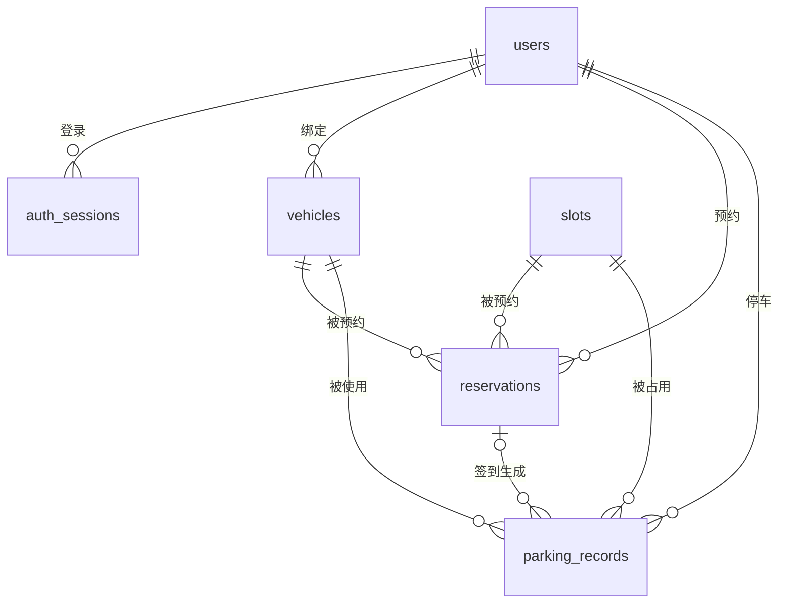

# VoltPark 数据库设计

VoltPark 使用 **SQLite 3** 作为本地数据库，数据库文件为 `data/voltpark.db`。不需要安装 MySQL / SQL Server，也不需要单独启动数据库服务：Python 标准库 `sqlite3` 直接读写这个文件，首次启动自动建表并写入演示数据。

- 建表、连接、演示数据：`db.py`
- 业务读写：`server.py`（全部使用参数化 SQL）
- 数据库文件：`data/voltpark.db`
- 建表语句导出：[voltpark_schema.sql](voltpark_schema.sql)（可直接在 SQLite 工具中执行）
- 模式：WAL（`journal_mode=WAL`）、外键约束开启（`PRAGMA foreign_keys=ON`）

## 1. 数据表

### users — 用户

| 字段 | 类型 | 约束 | 说明 |
| --- | --- | --- | --- |
| id | INTEGER | PK, AUTOINCREMENT | 用户编号 |
| name | TEXT | NOT NULL | 昵称 |
| email | TEXT | NOT NULL, UNIQUE, NOCASE | 登录邮箱，大小写不敏感 |
| password_hash | TEXT | NOT NULL | PBKDF2-SHA256 哈希（含盐），不存明文 |
| role | TEXT | NOT NULL, `CHECK (role IN ('user','admin'))` | 车主 / 管理员 |
| avatar_color | TEXT | NOT NULL | 头像底色 |
| created_at | TEXT | NOT NULL | 注册时间（UTC ISO 8601） |

### auth_sessions — 登录会话

| 字段 | 类型 | 约束 | 说明 |
| --- | --- | --- | --- |
| id | INTEGER | PK | |
| token_hash | TEXT | NOT NULL, UNIQUE | 会话令牌的 SHA-256 指纹，不存原始令牌 |
| user_id | INTEGER | NOT NULL, FK → users(id) ON DELETE CASCADE | 所属用户 |
| created_at | TEXT | NOT NULL | 签发时间 |
| expires_at | TEXT | NOT NULL | 过期时间（7 天） |

索引：`idx_auth_sessions_user`、`idx_auth_sessions_expiry`。

### vehicles — 车辆

| 字段 | 类型 | 约束 | 说明 |
| --- | --- | --- | --- |
| id | INTEGER | PK | |
| user_id | INTEGER | NOT NULL, FK → users(id) ON DELETE CASCADE | 车主 |
| plate_no | TEXT | NOT NULL, NOCASE | 车牌号 |
| model | TEXT | NOT NULL | 车型 |
| battery_kwh | REAL | NOT NULL, 默认 60 | 电池容量 |
| connector | TEXT | NOT NULL | 充电接口（国标直流 / 国标交流） |
| color | TEXT | NOT NULL | 卡片颜色 |
| is_primary | INTEGER | `CHECK IN (0,1)` | 是否默认车辆 |
| is_active | INTEGER | `CHECK IN (0,1)` | 解绑采用归档，历史账单不丢 |
| created_at | TEXT | NOT NULL | 绑定时间 |

索引：`idx_vehicles_user`；部分唯一索引 `idx_vehicles_active_plate (user_id, plate_no) WHERE is_active = 1`，保证同一用户的有效车辆不重复，解绑后可重新绑定同一车牌。

### slots — 车位

| 字段 | 类型 | 约束 | 说明 |
| --- | --- | --- | --- |
| id | INTEGER | PK | |
| code | TEXT | NOT NULL, UNIQUE | 车位编号，如 `A-03` |
| zone | TEXT | NOT NULL | 区域 A / B / C |
| level | TEXT | NOT NULL | 楼层，默认 B1 |
| kind | TEXT | `CHECK IN ('dc','ac','parking')` | 快充 / 慢充 / 普通停车 |
| power_kw | REAL | NOT NULL | 充电功率，停车位为 0 |
| connector | TEXT | NOT NULL | 接口类型 |
| price_per_hour | REAL | NOT NULL | 停车单价（元/小时） |
| status | TEXT | `CHECK IN ('open','maintenance')` | 开放 / 维护 |
| sort_order | INTEGER | NOT NULL | 展示顺序 |

共 24 个车位：A 区 8 个 120 kW 直流快充，B 区 8 个 7 kW 交流慢充，C 区 8 个标准停车位。

### reservations — 预约

| 字段 | 类型 | 约束 | 说明 |
| --- | --- | --- | --- |
| id | INTEGER | PK | |
| user_id | INTEGER | NOT NULL, FK → users(id) | 预约人 |
| vehicle_id | INTEGER | NOT NULL, FK → vehicles(id) | 预约车辆 |
| slot_id | INTEGER | NOT NULL, FK → slots(id) | 目标车位 |
| start_at / end_at | TEXT | NOT NULL | 预约时段（UTC ISO 8601） |
| status | TEXT | `CHECK IN ('reserved','active','completed','cancelled','expired')` | 预约状态 |
| note | TEXT | NOT NULL, 默认空串 | 备注 |
| created_at | TEXT | NOT NULL | 创建时间 |

索引：`idx_reservations_slot_time (slot_id, start_at, end_at)` 用于冲突检测，`idx_reservations_user (user_id, start_at)` 用于个人记录。

### parking_records — 停车 / 充电订单

| 字段 | 类型 | 约束 | 说明 |
| --- | --- | --- | --- |
| id | INTEGER | PK | |
| user_id | INTEGER | NOT NULL, FK → users(id) | 车主 |
| vehicle_id | INTEGER | NOT NULL, FK → vehicles(id) | 车辆 |
| slot_id | INTEGER | NOT NULL, FK → slots(id) | 车位 |
| reservation_id | INTEGER | FK → reservations(id) ON DELETE SET NULL | 来源预约（可空） |
| started_at | TEXT | NOT NULL | 入场时间 |
| ended_at | TEXT | 可空 | 离场时间；为空表示进行中 |
| energy_kwh | REAL | NOT NULL, 默认 0 | 充电量 |
| parking_fee / energy_fee / total_fee | REAL | NOT NULL, 默认 0 | 停车费 / 服务费 / 合计 |
| status | TEXT | `CHECK IN ('active','completed')` | 进行中 / 已完成 |
| created_at | TEXT | NOT NULL | 创建时间 |

关键约束：

- `idx_parking_active_slot (slot_id) WHERE ended_at IS NULL`：一个车位同时只能有一辆车。
- `idx_parking_active_user (user_id) WHERE ended_at IS NULL`：一个账号同时只能有一个进行中订单。
- `idx_parking_user (user_id, started_at)`、`idx_parking_slot (slot_id, ended_at)` 支撑历史与统计查询。

## 2. 关系



- 预约签到后生成一条 `parking_records`，`reservation_id` 指回预约。
- 结束订单时释放车位（`ended_at` 置值即视为释放），预约状态同步更新。
- 用户、车辆删除采用 `ON DELETE CASCADE`；车辆解绑只用 `is_active=0` 归档，避免账单悬空。

## 3. 演示数据与自动维护

首次启动（`users` 表为空）会写入：

- 5 个演示账号、6 辆电动车、24 个车位（B-08、C-08 维护中）；
- 3 条进行中的停车 / 充电订单；
- 4 条预约（含 1 条当前时段）；
- 9 条已完成历史账单。

为避免“隔几周再打开、演示数据全部过期”的问题，启动时会做两件事：

1. `ensure_demo_freshness()`：如果 4 个演示账号连续 40 小时没有任何操作、也没有进行中订单或未来预约，就以当前时间重新生成演示订单与预约。**只处理演示账号，自己注册的账号及其数据不会被动。**
2. `settle_stale_sessions()`：单笔订单最长 24 小时，超时订单按 24 小时自动结算并释放车位，避免出现“停了 18 天、账单 2600 元”的异常数据。

想彻底恢复出厂数据，停止服务后删除 `data/voltpark.db`（及 `-wal`、`-shm`）再启动即可。删除前请先备份，因为本地注册的账号也会一并删除。

## 4. 常用查询

以下 SQL 可直接在 DB Browser for SQLite、DBeaver 或 `sqlite3` 命令行中执行。

### 4.1 各区域车位状态

```sql
SELECT s.zone,
       COUNT(*) AS total,
       SUM(CASE WHEN s.status = 'maintenance' THEN 1 ELSE 0 END) AS maintenance,
       SUM(CASE WHEN s.status = 'open' AND p.id IS NOT NULL THEN 1 ELSE 0 END) AS occupied,
       SUM(CASE WHEN s.status = 'open' AND p.id IS NULL THEN 1 ELSE 0 END) AS free
FROM slots s
LEFT JOIN parking_records p ON p.slot_id = s.id AND p.ended_at IS NULL
GROUP BY s.zone
ORDER BY s.zone;
```

当前结果：

| zone | total | maintenance | occupied | free |
| --- | ---: | ---: | ---: | ---: |
| A | 8 | 0 | 1 | 7 |
| B | 8 | 1 | 1 | 6 |
| C | 8 | 1 | 1 | 6 |

### 4.2 当前在场车辆

```sql
SELECT s.code, v.plate_no, u.name, p.started_at
FROM parking_records p
JOIN slots s ON s.id = p.slot_id
JOIN vehicles v ON v.id = p.vehicle_id
JOIN users u ON u.id = p.user_id
WHERE p.ended_at IS NULL
ORDER BY p.started_at;
```

### 4.3 本月订单与营收

```sql
SELECT COUNT(*) AS orders,
       ROUND(COALESCE(SUM(energy_kwh), 0), 1) AS energy,
       ROUND(COALESCE(SUM(total_fee), 0), 2) AS revenue
FROM parking_records
WHERE status = 'completed'
  AND started_at >= '2026-10-31T16:00:00Z';   -- 2026-11-01 00:00（东八区）
```

当前结果：`8` 单、`132.5 kWh`、`246.75 元`。

### 4.4 用户消费排行

```sql
SELECT u.name, COUNT(*) AS orders, ROUND(SUM(p.total_fee), 2) AS spend
FROM parking_records p
JOIN users u ON u.id = p.user_id
WHERE p.status = 'completed'
GROUP BY u.id
ORDER BY spend DESC;
```

### 4.5 预约冲突检测（创建预约前的核心查询）

```sql
SELECT 1
FROM reservations
WHERE slot_id = ?                      -- 目标车位
  AND status IN ('reserved', 'active')
  AND start_at < ?                     -- 新预约结束时间
  AND end_at > ?;                      -- 新预约开始时间
```

命中即表示时段重叠，接口返回 `409 该时段已被预约`。

### 4.6 近 7 日充电量

```sql
SELECT date(started_at, '+8 hours') AS day,
       ROUND(SUM(energy_kwh), 1) AS kwh
FROM parking_records
WHERE status = 'completed'
  AND started_at >= datetime('now', '-7 days')
GROUP BY day
ORDER BY day;
```

## 5. 备份与查看

```powershell
# 备份（建议先停止服务）
Copy-Item data\voltpark.db data\voltpark-backup.db

# 用 Python 快速查看表结构和数据量
@'
import sqlite3
c = sqlite3.connect(r"data\voltpark.db")
for (name,) in c.execute("SELECT name FROM sqlite_master WHERE type='table'"):
    print(name, c.execute(f"SELECT COUNT(*) FROM {name}").fetchone()[0])
'@ | python -
```

也可以直接双击打开 `data\voltpark.db`（DB Browser for SQLite 等工具会自动识别），或使用 `sqlite3 data\voltpark.db` 进入命令行。

推荐图形化工具：DB Browser for SQLite（免费）、DBeaver、DataGrip。打开 `data/voltpark.db` 即可浏览、执行 SQL，不会影响正在运行的服务（SQLite 支持多进程读写，WAL 模式下读写可并发）。
